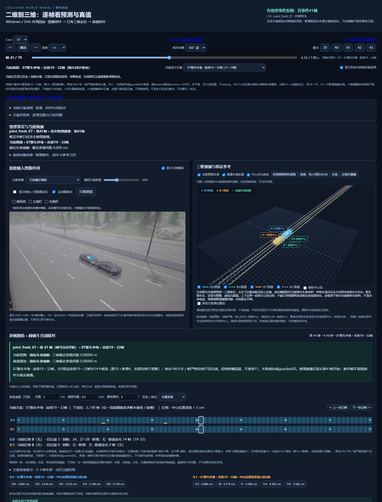
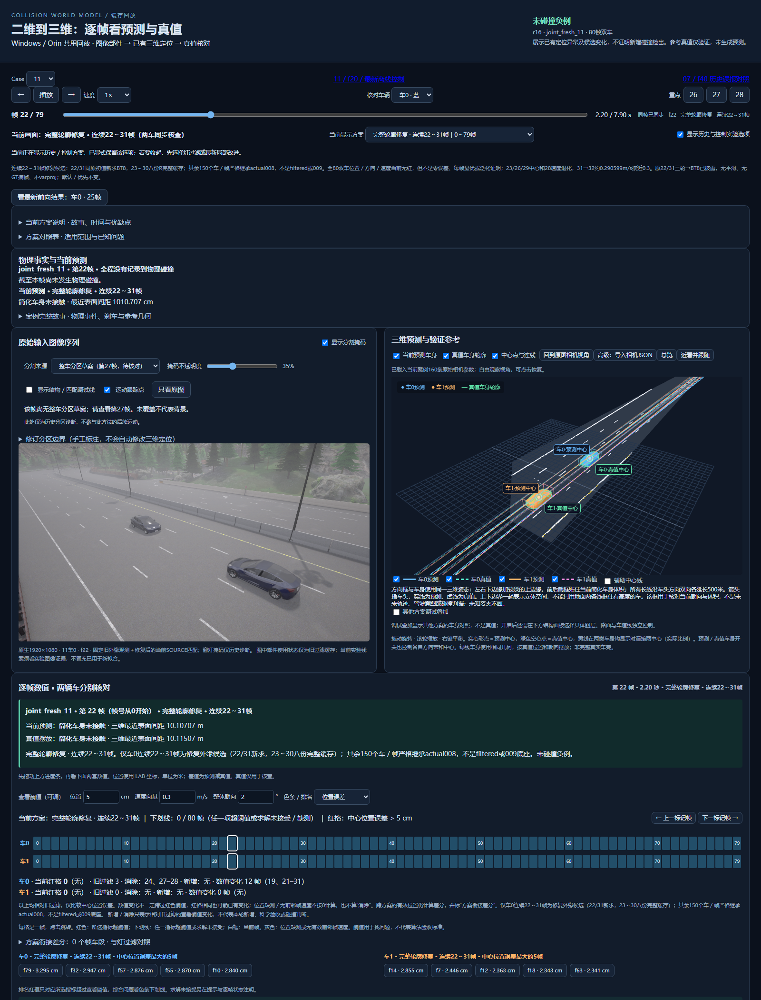

# Collision World | From visual relations to 3D contact inspection

[简体中文](README.md) | **English**

A research project exploring **how images can reveal the spatial relationship and contact between two vehicles**. One route learns vehicle relations and events from **V-JEPA visual features**; the other explicitly estimates **3D state from image contours and known geometry**. Training, inference, single-frame optimization and a local viewer make it possible to inspect the evidence from RGB images and masks through poses to contact distances.

**Start with the complete replay: once the data is downloaded, Python's standard library is enough to view two 80-frame clips.** No GPU, CARLA server or external model is needed. The viewer displays saved results; training and optimization have separate entry points.

## Start with the code walkthrough

[From purpose to code: did the two cars make contact?](docs/program_flow/output_html/从目的到代码_故事版.html) is an **offline walkthrough in Chinese**. It explains the two routes, then follows case 07 / car 0 / frame 28 from RGB and masks through correspondences and pose optimization to contact and velocity checks. Click the flow nodes to go deeper; expand the actual source snippets when needed. Improvements and unresolved problems appear alongside the steps they concern.

The walkthrough is a self-contained HTML file. GitHub's file view shows its source: download the file or clone the repository, then open it in a browser. Reading it needs no models, server or full dataset. Use the replay below to inspect actual RGB and 3D results. See the [walkthrough maintenance guide](docs/program_flow/README.md) for generation and checks.

## Running application

These are actual screenshots of the running local browser application, not interface mockups. They show original CARLA images, SAM masks, 3D projections and predicted/reference results.



Case 07, latest contour results at frame 41: both the prediction and reference indicate contact, with a displayed gap of 0. Position, orientation and velocity errors remain visible, including temporal errors that persist when an individual pose improves.



Case 11, latest contour results at frame 22: the vehicles have not made contact, allowing inspection of poses, projected contours and distance evidence. Both pages load images, calibration and display geometry from the repository, without online page resources.

## Why two routes?

The work began with relation learning and then investigated inspectable 3D geometry. The two routes address different questions:

| Route | Question and implementation | Runnable scope |
| --- | --- | --- |
| **Learn vehicle relations** | RGB → frozen V-JEPA features → a two-participant relation/contact/event student; CARLA provides training supervision | Student training, cached-feature inference, teacher generation and a small CPU acceptance check; full RGB encoding requires external official code and weights |
| **Estimate explicit geometry** | Image observations + calibration/geometric priors → 3D position and orientation → distance/contact inspection | Historical SurfaceNet training/inference; later SAM candidate selection, RGB edge extraction and contour optimization; complete result replay |

The geometry route also evolved. The earlier SurfaceNet predicts visible surfaces and fits rigid bodies; later methods constrain poses directly with part/whole-vehicle contours. The latest contour results in the viewer come from the latter. Training SurfaceNet does not generate those results automatically. The two routes have not been combined into a general end-to-end model for arbitrary video.

## Open the complete replay in three minutes

Install **Python 3.10+, Git and Git LFS**, then run:

```bash
git clone https://github.com/guanlinyi/collision_world.git
cd collision_world
git lfs install --local
git lfs pull
python -S -B start_full_replay.py
```

Initial download time depends on your connection. Source, selected data and showcase materials total approximately **458 MB**, including about 408 MB for 160 original RGB images. Git history and the local LFS cache require additional space. RGB images, selected NPZ data and the personal historical small checkpoints use Git LFS; cloning as above is the recommended way to obtain the complete data.

Open either page in your browser:

- [Case 07: contour optimization, vehicle 0 / frame 28](http://127.0.0.1:8883/cases/07/#frame=28&car=0&method=case07_far_exterior_bt8)
- [Case 11: two-vehicle replay, vehicle 0 / frame 22](http://127.0.0.1:8883/cases/11/#frame=22&car=0&method=contiguous_exact_contour_bt8)

Switch frames, vehicles and historical methods to compare RGB, masks, predicted poses and reference geometry. Press **Ctrl+C** in the terminal to stop. If the port is occupied, run `python -S -B start_full_replay.py --port 8893` and change the URL port to 8893.

A lighter numerical viewer is also available: run `python -S -B start_replay.py` and open `http://127.0.0.1:8882/`. It can load `world.json` exported by geometry inference. Its boxes illustrate poses; use the viewer on port 8883 for original RGB, masks and SOURCE display geometry.

## Inputs, data and dependencies

| Task | Included in the repository | Additional requirements |
| --- | --- | --- |
| Complete replay of both clips | 160 original RGB images, SAM masks/boundaries, calibration, predicted/reference poses, SOURCE display geometry and distances | Python standard library; complete Git LFS download |
| Recompute the latest single frame | Case 07 / vehicle 0 / frame 28 RGB, cached SAM candidates, prompts/ROI, observations, priors, calibration, ground and SOURCE triangles | The corresponding `requirements.txt`; candidate selection, actual RGB edge extraction and optimization can be rerun from cached candidates |
| Historical geometry inference | Personal historical small checkpoints, a real CARLA subset of 35 views / 6 states, saved proposals and native masks | Geometry dependencies including NumPy, SciPy and PyTorch |
| Relation student training | Student training/inference, teacher generation and synthetic input generation | PyTorch and related dependencies; real training needs features and labels prepared in the documented format |
| New scenes / full retraining | Input contracts, selected recording/export tools and external model interfaces | Matching CARLA server/assets, full data, identities/calibration/priors; official V-JEPA and SAM code/large weights as needed |

Runtime paths resolve relative to the project. Replay and bundled examples need no original workstation or external disk. SAM masks are prompt-conditioned model outputs rather than manual semantic ground truth. The geometry subset comes from a previously seen training episode and checks the input contract and inference; it is not an independent test set. See [data documentation](datasets/README.md).

## Run and validate by stage

Run all commands from the repository root. Replay checks use only the standard library:

```bash
python -S -B inspect_predictions/code/verify_replay.py
python -S -B inspect_predictions/code/verify_full_replay.py
```

The first independently checks position, adjacent-frame velocity and contact numbers in the saved results. The second checks image resources over local HTTP and verifies original RGB hashes. Neither performs new visual perception.

### 1. Recompute the latest single-frame optimization

Install the stage dependencies in your project Python environment:

```bash
python -m pip install -r estimate_geometry/refine_contours/requirements.txt
python -B estimate_geometry/refine_contours/code/infer_frame.py --output estimate_geometry/refine_contours/experiments/my_frame28_run --verify-frozen
```

This rebuilds SOURCE geometry, selects correspondences and runs optimization from the bundled real cached observations. `--verify-frozen` reads the saved historical result only after the new prediction has been written. To rerun SAM candidate selection and RGB gradient observations before optimization, follow the [single-frame observation guide](estimate_geometry/observe_structure/README.md), which also documents an interface for external official SAM weights.

### 2. Run the personal historical geometry checkpoints

```bash
python -m pip install -r estimate_geometry/requirements.txt
python -B estimate_geometry/code/run.py infer --input datasets/carla_surface_sample/prepared_sample --model estimate_geometry/personal_checkpoint --output estimate_geometry/experiments/my_surface_run/output_npz --device cpu --include-reference
```

Outputs include surface predictions, geometric states, contact evaluation and `world.json`, which the lightweight viewer can open. `--include-reference` explicitly enables evaluation against reference truth. See the [geometry guide](estimate_geometry/README.md) for the full input contract and a small training example.

### 3. Check relation student training and inference

```bash
python -m pip install -r learn_relations/requirements.txt
python -B learn_relations/code/synthetic_smoke.py --output-dir learn_relations/experiments/my_relation_check
```

This generates synthetic features, performs two real CPU optimization epochs, saves/loads a checkpoint and runs inference. It also checks that removing all teacher fields leaves predictions unchanged. This verifies the software pipeline. See the [relation learning guide](learn_relations/README.md) for real CARLA training, RGB encoding and teacher preparation.

Use a **new output directory** for every command that writes results; change the example name if it already exists. Tested environment: Windows, Python 3.12, NumPy 2.4.6, SciPy 1.17.1 and PyTorch 2.7.1+cu126. The reported acceptance computations used CPU. Fresh installations, Linux and Jetson Orin have not been validated.

## Results and remaining work

| Evidence | Conclusion and scope |
| --- | --- |
| Two 80-frame clips, 320 vehicle poses in total | All 2,240 PNG URLs passed HTTP checks; transmitted RGB hashes match the originals; actual browser views were inspected |
| Latest Case 11 results | No position, orientation or velocity cells exceed the viewer thresholds; this is a saved evaluation of this clip |
| Latest Case 07 results | Vehicle 0 maximum center error decreases from about 6.38 cm for the original filtered baseline to 3.90 cm; velocity cells at frames 19 and 33 remain red |
| Clip contact results | Saved geometric contact results have no false-positive or false-negative frames in these two clips; first contact in Case 07 is frame 41, matching the reference; this evaluates contact for the specified SOURCE geometry |
| Real single-frame reproduction | Case 07 / vehicle 0 / frame 28 took about 89.55 seconds on CPU with 6 accepted rounds; center, rotation and objective differences from the frozen result are all 0. This means consistent reproduction, not zero error against ground truth |
| Observation recomputation | Re-selecting cached SAM candidates reproduces the mask pixel for pixel; actual RGB processing yields 463 contour points and 248 gradient candidates with matching fields and values; the SAM neural network was not rerun |
| Training/inference in both routes | Small CPU training, save/load and inference checks pass on synthetic inputs; historical geometry checkpoints run on the real, previously seen 35-view subset. Full historical training scores were not reproduced |

The main current assumptions are **known assets, identities, camera calibration, ground and priors**. Some offline variants also use future RGB templates. The latest core was recomputed for only the frame listed above; the complete clips display existing results. Official-weight V-JEPA RGB extraction, SAM neural inference, full-clip recomputation, real-road accident recognition and cross-scene generalization were not completed in this acceptance round. Geometric contact is distinct from accident recognition, and the evidence does not support a general accident accuracy claim. See [validation records](docs/VALIDATION.md) for evidence and outstanding work.

## Repository map

```text
collision_world/
├── start_full_replay.py        Complete RGB/mask/3D replay entry
├── start_replay.py             Lightweight numerical replay entry
├── learn_relations/            Relations, contact and events from V-JEPA features
├── estimate_geometry/          Historical SurfaceNet training/inference and small checkpoints
│   ├── observe_structure/     SAM candidate selection and actual RGB edge extraction
│   └── refine_contours/       Latest explicit single-frame contour optimization
├── inspect_predictions/       Web viewers, replay servers and independent checks
├── datasets/                  CARLA replay data, real subset and recording tools
├── docs/                      Validation evidence, provenance/release notes and screenshots
└── SOURCE_MANIFEST.json        Source paths, adaptations and file hashes
```

## Provenance and third-party materials

CARLA-generated images, masks and SOURCE geometry retain their asset attribution. The original Three.js license text is included in [LICENSE_Three.txt](inspect_predictions/web_rich/input_txt/LICENSE_Three.txt). Official V-JEPA and SAM large weights are not bundled; obtain external code and weights from their official projects and follow their applicable terms.

- [Official V-JEPA project](https://github.com/facebookresearch/vjepa2)
- [Official SAM 2 project and checkpoints](https://github.com/facebookresearch/sam2)
- [Official CARLA project and license notes](https://github.com/carla-simulator/carla#licenses)
- [Repository provenance manifest](SOURCE_MANIFEST.json) · [Third-party and release notes](docs/RELEASE.md)

The repository does not apply a blanket MIT license to all source code, data and third-party assets. Their provenance and applicable terms are retained separately.
