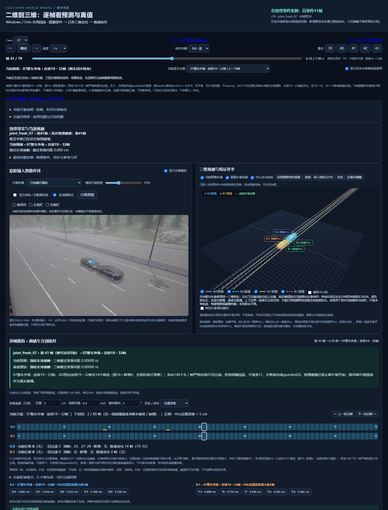
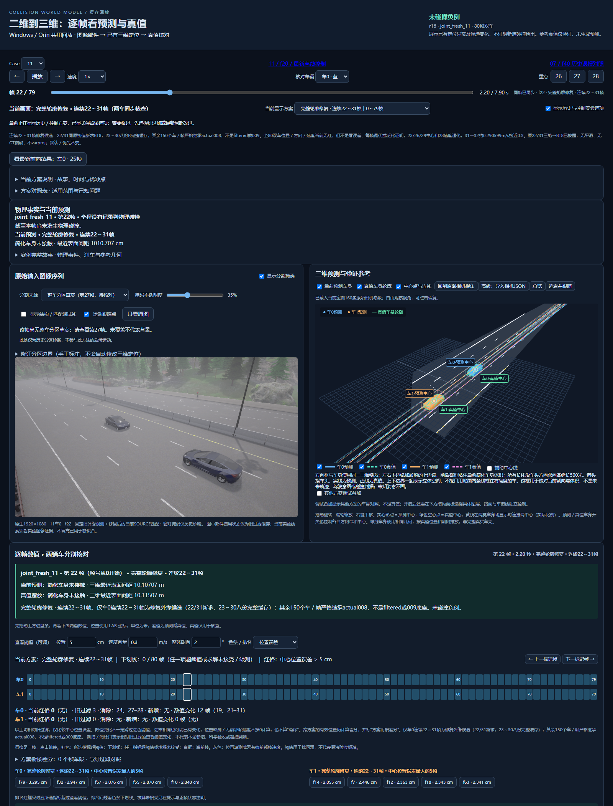

# Collision World｜从视频关系学习到三维接触核查

**简体中文** | [English](README.en.md)

探索“如何从图像判断两辆车的空间关系与接触”的研究工程：一条路线用 **V-JEPA 视觉特征学习车辆关系和事件**，另一条路线用 **二维轮廓与已知几何显式求解三维状态**。项目提供训练、推理、单帧求解和本地可视化入口，方便沿着原 RGB、掩码、三维姿态和接触距离逐层核对结果。

**最快体验：下载完整数据后，只用 Python 标准库就能打开两段各 80 帧的完整回放。** 无需 GPU、CARLA 服务或外部模型；页面展示已有结果，重新训练和重新求解有各自入口。

## 想先弄懂这个项目，就从这里看

[从目的到代码：两辆车到底有没有接触](docs/program_flow/output_html/从目的到代码_故事版.html)

先讲我们到底想判断什么，再把两条路线分开，接着跟着案例07、车0、第28帧，看原图、掩码、二维与三维的对应、摆车求解，最后怎样核对距离和速度。流程框可以逐层点进去，相关的真实代码默认收起，想看时再展开。已有改善和还没解决的问题也放在对应环节里。

**这是一个可以离线打开的单文件 HTML。** GitHub 文件页显示的是源码；下载该文件，或克隆仓库后双击打开即可。读这份解读不需要模型、服务或完整数据。它解释程序怎样工作；查看原图和三维结果，请继续打开下面的回放页。维护与重新生成方法见[解读说明](docs/program_flow/README.md)。

## 实际运行界面

以下是项目在本地浏览器中的真实运行截图，并非界面草图，展示 CARLA 原图、SAM 掩码、三维投影及预测／参考结果。



案例07最新轮廓结果，第41帧：参考与预测均进入接触，显示间隙为 0。页面保留位置、方向与速度误差，便于发现单帧改善后仍存在的时序问题。



案例11最新轮廓结果，第22帧：双车尚未接触，可核对姿态、投影轮廓和距离证据。两页均使用仓库内的原图、标定及显示几何，无需联网加载页面资源。

## 为什么保留两条路线

项目从关系学习出发，进一步研究可检查的三维几何。两条路线分别回答不同问题：

| 路线 | 主要问题与实现 | 当前可运行范围 |
| --- | --- | --- |
| **学习车辆关系** | RGB → 冻结 V-JEPA 特征 → 双参与者关系／接触／事件学生；CARLA 提供训练监督 | 学生模型训练、缓存特征推理、教师生成和小型 CPU 验收；完整 RGB 编码需外部官方代码与权重 |
| **显式估计几何** | 图像观测＋标定／几何先验 → 三维位置与方向 → 距离和接触核查 | 历史 SurfaceNet 训练／推理；后续 SAM 候选选择、RGB 边提取与轮廓求解；完整结果回放 |

几何路线本身也有演进：早期 SurfaceNet 预测可见表面并拟合刚体，后续方法直接利用部件／整车轮廓约束姿态。网页中的最新轮廓结果来自后者；运行 SurfaceNet 训练不会自动生成这些结果。两条路线目前也没有串成一个任意视频输入的通用端到端模型。

## 三分钟打开完整回放

准备 **Python 3.10+、Git 和 Git LFS**。以下命令从终端执行：

```bash
git clone https://github.com/guanlinyi/collision_world.git
cd collision_world
git lfs install --local
git lfs pull
python -S -B start_full_replay.py
```

首次下载时间取决于网络。源码、样本与展示材料合计约 **458 MB**，其中 160 张原 RGB 约 408 MB；Git 历史和本地 LFS 缓存会额外占空间。RGB、部分 NPZ 和个人历史小型权重通过 Git LFS 管理，推荐使用上述克隆方式获取完整数据。

浏览器打开：

- [案例07：轮廓求解，车0／第28帧](http://127.0.0.1:8883/cases/07/#frame=28&car=0&method=case07_far_exterior_bt8)
- [案例11：双车几何回放，车0／第22帧](http://127.0.0.1:8883/cases/11/#frame=22&car=0&method=contiguous_exact_contour_bt8)

可以切换帧、车辆和历史方案，对照原 RGB、掩码、预测姿态及参考几何。终端按 **Ctrl+C** 停止。端口占用时运行 `python -S -B start_full_replay.py --port 8893`，并把网址端口改为 8893。

另有轻量数值页：`python -S -B start_replay.py`，打开 `http://127.0.0.1:8882/`。它可读取几何推理导出的 `world.json`，其中示意盒用于查看姿态；完整 RGB／掩码／SOURCE 显示几何请使用 8883 页面。

## 输入、数据与依赖

| 任务 | 仓库已包含 | 还需要什么 |
| --- | --- | --- |
| 两段完整回放 | 160 张原 RGB、SAM 掩码／边界、标定、预测与参考姿态、SOURCE 显示几何和距离结果 | Python 标准库；完整拉取 Git LFS 数据 |
| 最新单帧重新求解 | 案例07／车0／第28帧的 RGB、缓存 SAM 候选、提示／ROI、观测、先验、标定、地面与 SOURCE 三角形 | 对应 `requirements.txt`；可以从缓存候选重做选择、真实 RGB 边提取和求解 |
| 历史几何模型推理 | 个人已有小型权重、真实 CARLA 35 视图／6 状态子集、已有 proposal 和 native mask | NumPy、SciPy、PyTorch 等几何路线依赖 |
| 关系模型训练 | 学生训练与推理代码、教师生成代码、合成输入生成器 | PyTorch 等依赖；真实训练需准备符合协议的特征与标签 |
| 新场景／完整重训 | 输入协议、部分采集／导出工具、外部模型接口 | 匹配的 CARLA 服务和资产、完整数据、身份／标定／先验；V-JEPA、SAM 官方代码与大权重按需准备 |

运行时路径按项目位置解析，回放与已打包样例无需旧磁盘或原工作目录。SAM 掩码是提示条件下的模型产物，不是人工语义真值；几何模型子集来自已见训练片段，用于核对输入协议和推理，不能作为独立测试集。详见[数据说明](datasets/README.md)。

## 分层运行与验收

所有命令均从仓库根目录执行。回放核查只需标准库：

```bash
python -S -B inspect_predictions/code/verify_replay.py
python -S -B inspect_predictions/code/verify_full_replay.py
```

第一条独立核对冻结结果中的位置、相邻帧速度及接触数值；第二条通过本地 HTTP 检查两个页面的图像资源与原 RGB 哈希。它们不重新做图像感知。

### 1. 重新运行最新单帧求解

在项目 Python 环境中安装该步骤依赖后执行：

```bash
python -m pip install -r estimate_geometry/refine_contours/requirements.txt
python -B estimate_geometry/refine_contours/code/infer_frame.py --output estimate_geometry/refine_contours/experiments/my_frame28_run --verify-frozen
```

入口从打包的真实缓存观测重新构建 SOURCE 几何、选择对应关系并迭代求解。`--verify-frozen` 在新预测保存后才读取冻结结果作比较。若要先重做 SAM 候选选择和 RGB 梯度观测，再接入求解，见[单帧前端说明](estimate_geometry/observe_structure/README.md)；其中也提供使用外部官方 SAM 权重的接口。

### 2. 运行个人历史几何权重

```bash
python -m pip install -r estimate_geometry/requirements.txt
python -B estimate_geometry/code/run.py infer --input datasets/carla_surface_sample/prepared_sample --model estimate_geometry/personal_checkpoint --output estimate_geometry/experiments/my_surface_run/output_npz --device cpu --include-reference
```

输出表面预测、几何状态、接触评价及 `world.json`；可用轻量回放页打开。`--include-reference` 显式启用参考真值评价。完整输入契约及小型训练命令见[几何路线说明](estimate_geometry/README.md)。

### 3. 检查关系学生训练与推理

```bash
python -m pip install -r learn_relations/requirements.txt
python -B learn_relations/code/synthetic_smoke.py --output-dir learn_relations/experiments/my_relation_check
```

该检查生成合成特征，执行真实的两轮 CPU 优化、保存／加载和推理，并核对去掉教师字段后推理结果不变。它验证软件链路；真实 CARLA 训练、RGB 编码和教师准备见[关系学习说明](learn_relations/README.md)。

以上写出结果的命令都应使用**新的输出目录**；示例目录已存在时，请更换名称。已测环境为 Windows、Python 3.12、NumPy 2.4.6、SciPy 1.17.1、PyTorch 2.7.1+cu126，列出的验收计算使用 CPU；全新安装、Linux 和 Jetson Orin 尚未完成验收。

## 已完成与仍待解决

| 已有证据 | 实际结论与边界 |
| --- | --- |
| 两段各 80 帧、共 320 个车辆姿态的完整回放 | 2240 个 PNG URL 通过 HTTP 检查，传输 RGB 哈希与原图一致；已检查实际浏览器画面 |
| 案例11最新结果 | 位置、方向、速度均无页面阈值红格；这是这一片段的冻结评价 |
| 案例07最新结果 | 车0最大中心误差从原过滤基线约 6.38 cm 降至 3.90 cm；第19、33帧仍有速度红格 |
| 片段接触结果 | 两段已有片段的冻结几何接触无误报／漏报，案例07首次接触为第41帧、与参考匹配；这是所用 SOURCE 几何的接触核查 |
| 真实单帧求解复现 | 案例07／车0／第28帧在 CPU 上约 89.55 秒，接受 6 轮；中心、转角、目标值与冻结结果之差均为 0，表示复现一致，不是对真值误差为 0 |
| 上游观测重算 | 缓存 SAM 候选重新选择后掩码逐像素一致；真实 RGB 重算得到 463 个轮廓点、248 个梯度候选，字段与数值一致；未重跑 SAM 神经网络 |
| 两路线训练／推理 | 合成输入的小型 CPU 训练与保存／推理通过；历史几何权重在真实已见 35 视图子集推理通过，未复现完整历史训练成绩 |

当前主要限制是**已知资产、身份、相机标定、地面和先验**；部分离线方案还使用未来 RGB 模板。最新核心仅重新求解了上述一帧，两个完整片段展示的是已有结果。V-JEPA 官方权重 RGB 提取、SAM 神经前向、全片段重算、真实道路事故识别和跨场景泛化均未在本次验收中完成。几何接触不等于事故识别，现有证据不足以报告通用事故准确率。完整证据与未完成项见[验收记录](docs/VALIDATION.md)。

## 目录地图

```text
collision_world/
├── start_full_replay.py        完整原图／掩码／三维回放入口
├── start_replay.py             轻量数值回放入口
├── learn_relations/            V-JEPA特征上的关系、接触与事件学习
├── estimate_geometry/          SurfaceNet历史训练、推理与已有小权重
│   ├── observe_structure/     SAM候选选择与真实RGB边提取
│   └── refine_contours/       最新单帧显式轮廓求解
├── inspect_predictions/       网页、回放服务与独立核验
├── datasets/                  CARLA回放数据、真实小子集与采集工具
├── docs/                      验收证据、来源／发布说明与运行截图
└── SOURCE_MANIFEST.json        来源路径、改动与文件哈希清单
```

## 来源与第三方材料

CARLA 生成图像、掩码及 SOURCE 几何保留其资产来源；Three.js 的原许可文本见 [LICENSE_Three.txt](inspect_predictions/web_rich/input_txt/LICENSE_Three.txt)。V-JEPA 和 SAM 官方大权重未打包，外部代码与权重应从各自官方项目获取并遵循对应条件。

- [V-JEPA 官方项目](https://github.com/facebookresearch/vjepa2)
- [SAM 2 官方项目与权重说明](https://github.com/facebookresearch/sam2)
- [CARLA 官方项目与许可说明](https://github.com/carla-simulator/carla#licenses)
- [仓库来源清单](SOURCE_MANIFEST.json) · [第三方与发布说明](docs/RELEASE.md)

仓库没有为所有源码、数据和第三方资产统一授予 MIT 许可；各材料的来源与适用条件分别保留。
